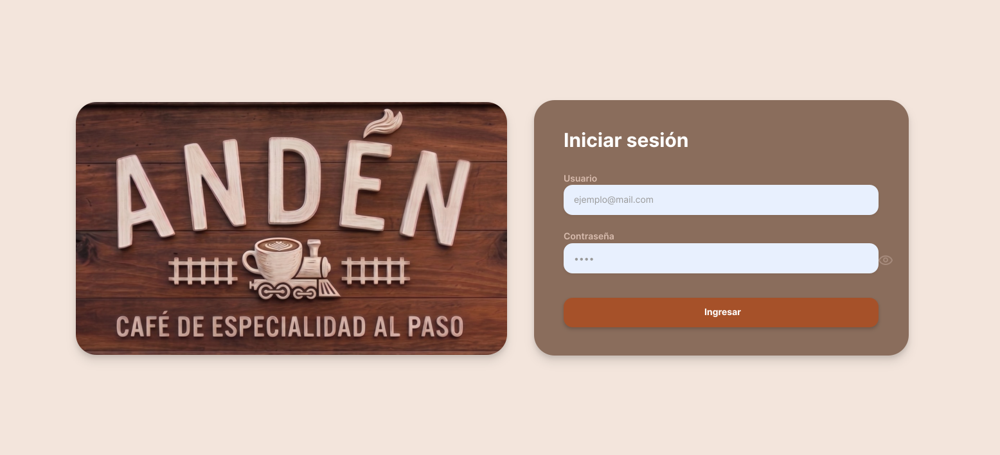

# NextByte Café ☕

Sistema de gestión operativa para cafeterías y locales gastronómicos: toma de pedidos, visor de cocina (comandas), recetas, control de stock de insumos y registro de movimientos de caja.

> **Alcance del Sistema:** NextByte Café está enfocado 100% en la **operación interna diaria del local y la cocina** (agilizar el despacho de pedidos, controlar el gasto de materia prima por receta y organizar los turnos). **No es un sistema contable ni de facturación fiscal**.

---

## 📥 Enlace de Descarga de la Aplicación

Si querés probar la aplicación de escritorio empaquetada (ejecutable de Windows) sin necesidad de compilar el código fuente:

👉 **[Descargar Instalador de NextByte Café para Windows (.exe)](https://github.com/Matihp/nextbyte-gestion-cafe/releases/latest)**  

---

## 1. Arquitectura del Sistema

El sistema utiliza una separación clara entre Frontend y Backend:

```
┌────────────────────────────────────────────────────────┐
│               Frontend (React 19 + Vite)              │
│       Tailwind CSS v4 + Shadcn UI + Recharts          │
└───────────────────────────┬────────────────────────────┘
                            │ HTTP / REST API (Axios + JWT)
                            ▼
┌────────────────────────────────────────────────────────┐
│             Backend (Node.js + Express)                │
│    Arquitectura en Capas: Routes → Controllers         │
│          → Services (Lógica) → Repositories            │
└───────────────────────────┬────────────────────────────┘
                            │ Knex.js Query Builder
                ┌───────────┴───────────┐
                ▼                       ▼
┌──────────────────────────────┐  ┌──────────────────────────────┐
│  SQLite Local (dev_local.db) │  │   Turso Cloud (libSQL)       │
│  Base por defecto (Offline)  │  │   Base Centralizada (Online) │
└──────────────────────────────┘  └──────────────────────────────┘
                ▲                               │
                │     syncJob (Background)      │
                └───────────────────────────────┘
                  Sincronización automática
```

### Tecnologías:
* **Frontend:** React 19, Vite, Tailwind CSS v4, Lucide React (iconos), Sonner (notificaciones), Recharts (gráficos), Axios.
* **Backend:** Node.js (v18+), Express, Knex.js (Query Builder), BcryptJS (contraseñas seguras), JsonWebToken (autenticación).
* **Base de Datos Híbrida:** SQLite 3 local (`dev_local.db`) + Turso Cloud libSQL (para sincronización remota).
* **Testing:** Jest + Supertest (302 pruebas automatizadas pasando).

---

## 2. Estructura del Proyecto

### Frontend (`/frontend`)
* `src/features/pedidos`: Grilla de productos, carrito de pedidos, selección de modalidad (mostrador/delivery), medio de pago, emisión de comprobante de comanda y descuento de ingredientes en tiempo real.
* `src/features/comandas`: Visor de pedidos para cocineros con cambio de estados (*Pendiente*, *En preparación*, *Listo*, *Entregado*).
* `src/features/clientes`: Pantalla de clientes (`CustomerViewerPage`), visor público para ver órdenes en preparación y listas para retirar.
* `src/features/menu`: Carta de productos, categorías, administración de recetas (insumos por producto) y fotos en Cloudinary.
* `src/features/inventario`: Materias primas (café en grano, leche, harinas) con unidad de medida, alertas de stock mínimo y registro de mermas o desperdicios justificados.
* `src/features/inventario/SuppliersPage`: Directorio de proveedores de materias primas.
* `src/features/caja`: Registro operativo de entradas y retiros de dinero de la jornada con fecha, hora y motivo.
* `src/features/empleados`: Ficha de personal con puestos asignados para vincularlos con las cuentas de usuario del software.
* `src/features/reportes`: Panel con métricas de pedidos por período y ranking de productos más pedidos.
* `src/features/configuracion`: Administración de usuarios, roles y permisos, y perfil del usuario logueado (con protección de seguridad que impide deshabilitar o quitar permisos al Administrador).
* `src/services/`: Conexión HTTP centralizada con Axios (`api.js`) con interceptores para adjuntar el token JWT.
* `src/context/`: `AuthContext` para el manejo de la sesión del usuario.

### Backend (`/backend`)
* `src/routes/`: Endpoints de la API REST (`auth`, `usuarios`, `roles`, `empleados`, `turnos`, `pedidos`, `categorias`, `productos`, `comandas`, `proveedores`, `insumos`, `mermas`, `caja`, `reportes`, `sync`).
* `src/controllers/`: Controladores que reciben la petición HTTP y envían las respuestas en formato JSON.
* `src/services/`: Lógica central (descuento de insumos por receta al vender, verificación de stock disponible, lógica de movimientos de caja y sincronización).
* `src/repositories/`: Consultas directas a la base de datos mediante Knex.
* `src/middlewares/`: Seguridad (JWT, control de roles), manejo de errores y middleware de conectividad (`checkConnection`).
* `src/db/migrations/`: Migraciones relacionales que construyen la base de datos.
* `src/db/seeds/`: Datos base de roles y usuario inicial.
* `src/jobs/`: `syncJob.js`, proceso en segundo plano que detecta cuando hay conexión y sincroniza los cambios pendientes con la nube.
* `tests/`: 21 suites y 302 pruebas automatizadas con Jest y Supertest.

---

## 3. Base de Datos y Persistencia

Modelo relacional normalizado con claves foráneas:

* **`empleados`**: Personal del local (nombre, legajo, puesto, teléfono).
* **`roles`**: Permisos del sistema (`Administrador`, `Cajero`, `Encargado`).
* **`usuarios`**: Cuentas de acceso con contraseña encriptada (bcrypt), vinculadas a un rol y empleado.
* **`categorias`**: Rubros de la carta (Cafetería, Bebidas, Entre Panes, Pastelería, Sin TACC, etc.).
* **`productos`**: Ítems para la venta con precio, categoría, stock actual y URL de foto.
* **`insumos`**: Materia prima (café en grano, leche, harina, etc.) con unidad de medida (lts, kg) y stock mínimo de alerta.
* **`recetas` e `ingredientes_recetas`**: Insumos requeridos para elaborar cada producto.
* **`pedidos` y `detalles_pedidos`**: Registro de pedidos tomados, número de orden, método de pago informado y estado de comanda.
* **`movimientos_caja`**: Registro operativo de entradas y retiros de efectivo con detalle y monto.
* **`registros_mermas`**: Registro de insumos o productos descartados con cantidad y motivo justificado.
* **`sync_pendientes`**: Cola local de operaciones guardadas en modo offline para replicar a Turso Cloud al recuperar conexión.

---

## 4. Instalación y Puesta en Marcha (Paso a Paso)

### Requisitos previos:
* **Node.js** (versión 18 o superior)
* **npm** (incluido con Node.js)
* **Git**

### Paso 1: Clonar el repositorio
```bash
git clone https://github.com/Matihp/nextbyte-gestion-cafe.git
cd nextbyte-gestion-cafe
```

---

### Paso 2: Iniciar el Backend
1. Abrí una terminal, entrá a `/backend` e instalá las dependencias:
   ```bash
   cd backend
   npm install
   ```

2. Creá tu archivo `.env` copiando el de ejemplo:
   ```bash
   cp .env.example .env
   ``` 
   El `.env` ya viene listo por defecto para usar SQLite local (`dev_local.db`).

3. Iniciá el servidor en modo desarrollo:
   ```bash
   npm run dev
   ```
   > **¿Qué pasa en este momento?**  
   > El servidor se levanta en `http://localhost:3000`. Detecta que no existe `dev_local.db`, lo crea automáticamente, corre las migraciones y carga los roles y el usuario administrador inicial.

---

### Paso 3: Iniciar el Frontend
1. Abrí una terminal, entrá a `/frontend` e instalá las dependencias:
   ```bash
   cd frontend
   npm install
   ```

2. Creá el archivo `.env`:
   ```bash
   cp .env.example .env
   ```
   Asegurate de que tenga:
   ```env
   VITE_API_URL=http://localhost:3000/api
   VITE_CLOUDINARY_CLOUD_NAME=ejemplo123
   VITE_CLOUDINARY_UPLOAD_PRESET=nextbyte_cafe
   ```

3. Iniciá la aplicación:
   ```bash
   npm run dev
   ```

4. Abrí tu navegador e ingresá a:
   👉 **`http://localhost:5173`**

---

## 5. Credenciales de Acceso

Para ingresar al sistema podés usar las cuentas precargadas:

| Rol | Correo Electrónico | Contraseña | Permisos |
| :--- | :--- | :--- | :--- |
| **Administrador** | `admin@nextbyte.com` | `admin123` | Acceso a configuración, carta, recetas, insumos, empleados y reportes operativos |
| **Cajero** | `caja@nextbyte.com` | `caja123` | Toma de pedidos, visualización de comandas y registro de movimientos de caja |

---

## 6. Vistas del Sistema

### 1. Inicio de Sesión
Acceso al sistema mediante credenciales con autenticación JWT y control de roles asignados.

<p align="center">
  
</p>

### 2. Panel Principal
Vista de bienvenida con accesos rápidos a los módulos operativos y navegación general.

<p align="center">
  
</p>

### 3. Toma de Pedidos
Catálogo visual con filtros por categoría, carrito interactivo, indicación de entrega/pago y emisión de comprobante de comanda.

<p align="center">
  
</p>

### 4. Visor de Comandas (Cocina / Barista)
Pantalla KDS en tiempo real para seguir el avance de las preparaciones (*Pendiente* ➔ *En preparación* ➔ *Listo* ➔ *Entregado*).

<p align="center">
  
</p>

### 5. Pantalla de Espera para Clientes (Turnero)
Visor público para colocar en tablet o monitor de cara al salón, mostrando los pedidos en preparación y los listos para retirar por número.

<p align="center">
  
</p>

### 6. Catálogo de Productos y Carta
Administración de productos a la venta, precios, categorías, recetas asociadas y fotos optimizadas en la nube.

<p align="center">
  
</p>

### 7. Inventario y Control de Insumos
Control de existencias de materia prima (café en grano, leche, harinas, etc.) con unidad de medida y avisos de stock mínimo o crítico.

<p align="center">
  
</p>

### 8. Directorio de Proveedores
Agenda con datos de contacto y rubro de los proveedores de insumos del local.

<p align="center">
  
</p>

### 9. Personal y Empleados
Ficha del equipo de trabajo, asignación de puestos (cajero, barista, encargado) y vinculación con usuarios del sistema.

<p align="center">
  
</p>

### 10. Estadísticas y Reportes
Gráficos interactivos de ventas por período y ranking de productos más pedidos.

<p align="center">
  
</p>

---

## 7. Comandos Útiles

### Backend (`/backend`)
| Comando | Descripción |
| :--- | :--- |
| `npm run dev` | Inicia el backend con nodemon. Crea `dev_local.db` y migra de forma automática. |
| `npm test` | Ejecuta las 302 pruebas automatizadas con Jest. |
| `npm run reset-db` | Borra `dev_local.db`, vuelve a aplicar migraciones y restaura los datos limpios. |
| `npm run migrate` | Ejecuta migraciones de forma manual con Knex. |
| `npm run seed` | Ejecuta las semillas base con Knex. |

### Frontend (`/frontend`)
| Comando | Descripción |
| :--- | :--- |
| `npm run dev` | Inicia el servidor de desarrollo Vite. |

---

## 8. Pruebas Automatizadas (Testing)

El sistema cuenta con una batería de pruebas con **Jest** y **Supertest** cubriendo validaciones de entrada, reglas de descuento de insumos por receta, registro de movimientos de caja, autenticación JWT y conmutación offline/online.

Para ejecutar todas las pruebas:
```bash
cd backend
npm test
```

**Resultado esperado:**
```text
Test Suites: 21 passed, 21 total
Tests:       302 passed, 302 total
Snapshots:   0 total
Time:        ~10s
```
